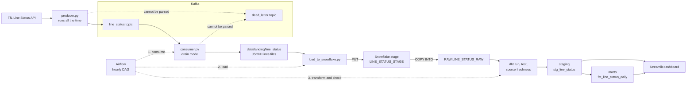
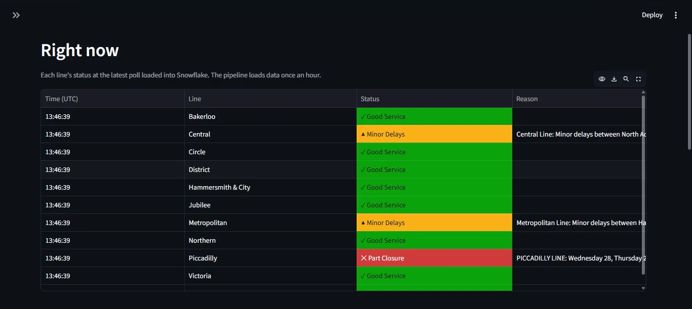
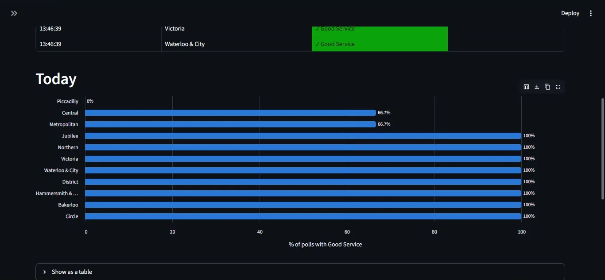
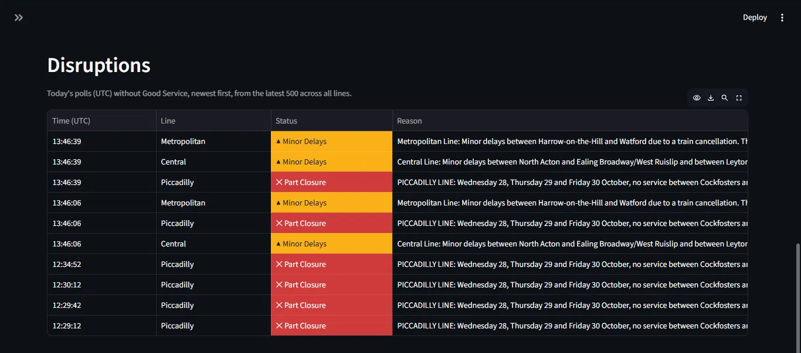
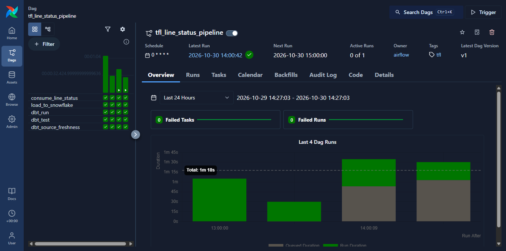
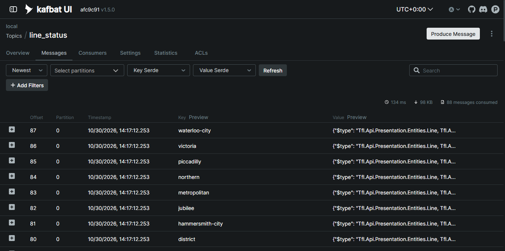
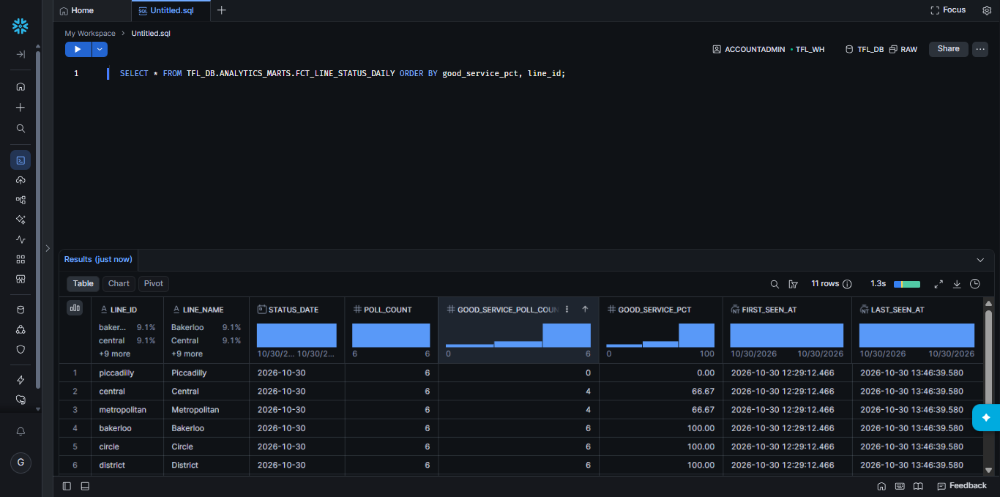

# TfL Real-Time Streaming Pipeline

An end-to-end data pipeline that streams live London Underground status through Kafka into Snowflake, transforms it with dbt, runs hourly on Airflow, and shows the results on a Streamlit dashboard.


**Results:** tracks 11 tube lines, polled every 30 seconds, through a 5-task Airflow DAG that runs hourly, with 20 dbt data tests defined.

## What it does

- **Collects live data:** a Python producer calls the TfL API every 30 seconds and sends each tube line's status to Kafka.
- **Stores it safely:** a consumer writes the messages to JSON Lines files, which are then loaded into Snowflake.
- **Transforms and tests it:** dbt removes duplicates, builds a daily summary and checks the data, with Airflow running everything once an hour.
- **Shows the results:** a Streamlit dashboard shows each line's latest status, today's % good service, and today's disruptions.

## Architecture



## Screenshots

**Dashboard: each line's latest status**



**Dashboard: today's % good service per line**



**Dashboard: today's disruptions with reasons**



**Airflow: the hourly pipeline**



**Kafka UI: messages in `line_status`, keyed by line id**



**Snowflake: the daily mart**



## Tech stack

| Area | Technology | Version | Pinned in |
|---|---|---|---|
| Message broker | Apache Kafka (KRaft mode, one broker) | `apache/kafka:4.3.2` | `docker/docker-compose.yml` |
| Kafka web UI | Kafbat Kafka UI | `kafbat/kafka-ui:v1.5.0` | `docker/docker-compose.yml` |
| Orchestration | Apache Airflow (standalone, Python 3.12) | `apache/airflow:3.3.2-python3.12` | `airflow/Dockerfile` |
| Kafka client | confluent-kafka | `2.16.1` | `requirements.txt` |
| HTTP client | requests | `2.34.2` | `requirements.txt` |
| Data warehouse | Snowflake (with snowflake-connector-python) | `4.8.1` | `requirements.txt` |
| Key generation | cryptography | `50.0.2` | `requirements.txt` |
| Transformation | dbt-core | `1.12.6` | `requirements.txt` |
| Transformation | dbt-snowflake | `1.12.4` | `requirements.txt` |
| Dashboard | Streamlit | `1.66.1` | `requirements.txt` |

## Project structure

```text
.
├── airflow/         Dockerfile for the Airflow image, and dags/ with the hourly pipeline
├── consumer/        Reads Kafka, writes JSON Lines batches, commits offsets
├── dashboard/       Streamlit app
├── data/samples/    Saved example responses from the TfL API
├── dbt/             dbt project: staging and marts models, tests, profiles.yml
├── docker/          Docker Compose stack, topic creation script, .env.example
├── docs/            Beginner notes (learnings.md) and screenshots (images/)
├── producer/        TfL API exploration script and the Kafka producer
├── snowflake/       Setup SQL (01, 02, 03), key generation, and the loader
└── requirements.txt Pinned Python packages
```

## Key design decisions

- **Keyed messages for ordering:** each message's key is its line id. Kafka sends the same key to the same partition, and order is guaranteed within a partition. `line_status` has one partition today, so this matters if it ever gets more.
- **Dead letter topic:** data that can't be parsed goes to `dead_letter` with the error, so one bad message doesn't stop the pipeline and can be inspected later.
- **Manual offset commits after writing (at-least-once):** the consumer commits only after a batch file is saved. A crash can cause duplicates, but it can't lose data.
- **Atomic file writes:** each batch is written to a `.tmp` file, flushed to disk, then renamed, so a half-written file never looks finished.
- **`COPY INTO` load history:** Snowflake skips files it has already loaded, so running the loader again doesn't load them twice.
- **Deduplication in dbt:** `stg_line_status` keeps one row per `kafka_partition` + `kafka_offset`, which removes duplicates that at-least-once delivery can create.
- **Key-pair login with least-privilege roles:** there are three service users with no passwords: loader (`TFL_LOADER_ROLE`), transformer (`TFL_TRANSFORMER_ROLE`), and read-only reporter (`TFL_REPORTER_ROLE`).
- **Cost controls:** an XSMALL warehouse with `AUTO_SUSPEND = 60`, plus a resource monitor that suspends it at 20 credits a month.
- **Producer outside Airflow:** a streaming producer never "finishes", but Airflow tasks must. The producer runs on its own and Kafka holds the messages until the next run.
- **Consumer drain mode:** with `CONSUMER_RUN_ONCE=true`, the consumer reads to the end of each partition, saves, commits and exits, so it can be an Airflow task. Without it, the consumer runs continuously.

## Problems I solved

- **`localhost` on Windows:** the Kafka client tried IPv6 (`[::1]`) first, but Docker only published the port on IPv4 `127.0.0.1`, causing connection errors. Setting `broker.address.family` to `v4` fixed it.
- **Snowsight running one statement at a time:** this lost the `USE SCHEMA` context between statements, so objects couldn't rely on it. The setup SQL now uses fully qualified names such as `TFL_DB.RAW.LINE_STATUS_RAW`, and is meant to be run one statement at a time.
- **dbt's parser package on Windows with Python 3.14:** dbt-core 1.12's `dbt-core-experimental-parser` dependency has no wheels in its current releases, so a wheels-only install fails. Its source package downloads a prebuilt wheel at install time and checks its SHA-256 hash, so a normal `pip install` is the route to use. The older dbt 1.11 line wasn't an option, because its Snowflake adapter's `certifi` limit conflicts with the connector pin.
- **Snowflake's time zone:** the trial account's default wasn't UTC, so `01_setup.sql` runs `ALTER ACCOUNT SET TIMEZONE = 'UTC'`, and the dbt models convert timestamps to UTC explicitly.
- **Two Kafka listeners:** programs on the laptop need `localhost:9092`, while containers need `kafka:29092`, because `localhost` inside a container means that container. Kafka advertises the right address to each.

## Data model

### `stg_line_status` (view, schema `ANALYTICS_STAGING`)

One row per tube line per poll, with duplicate messages removed. If a line has several statuses in one poll, the row keeps the lowest severity code.

| Column | Description |
|---|---|
| `line_id`, `line_name` | TfL's line id and name |
| `status_severity` | TfL's status code, from 0 to 20 (10 means Good Service) |
| `status_description` | The status in words |
| `reason` | TfL's explanation, when there is one |
| `ingested_at` | When the producer received the data, in UTC |
| `kafka_partition`, `kafka_offset` | Where the message was in Kafka; used for deduplication |
| `source_file` | The stage file the row came from |
| `loaded_at` | When the row was loaded into Snowflake, in UTC |

### `fct_line_status_daily` (table, schema `ANALYTICS_MARTS`)

One row per tube line per UTC day.

| Column | Description |
|---|---|
| `line_id`, `line_name` | The line |
| `status_date` | The UTC day |
| `poll_count` | Number of polls |
| `good_service_poll_count` | Polls with Good Service (code 10) |
| `good_service_pct` | Percentage of polls with Good Service |
| `first_seen_at`, `last_seen_at` | First and last poll of the day, in UTC |

### dbt tests

- **`not_null`:** on every column of both models, except `reason`, which is empty when service is good.
- **`accepted_values`:** `status_severity` must be a whole number from 0 to 20.
- **Uniqueness (SQL tests in `dbt/tests/`):** one row per `kafka_partition` + `kafka_offset` in staging, and one row per `line_id` + `status_date` in the mart.
- **Source freshness:** on `loaded_at`, with a warning after 1 hour and an error after 24 hours.

## How to run locally

For more detail on each step, see the [beginner notes in docs/learnings.md](docs/learnings.md).

### Prerequisites

- Windows with PowerShell (the commands below are written for it)
- Docker Desktop
- Python 3.14 (the laptop scripts were built on it; the Airflow image uses Python 3.12)
- A Snowflake account, where you can use `ACCOUNTADMIN`

No TfL API key is needed. The producer can run without one at a lower rate limit. To use one, set `$env:TFL_APP_KEY` in the terminal before starting the producer.

Run all commands from the project's main folder.

### Steps

**1. Get the code and install the packages**

```powershell
git clone <this repository's URL>
cd <the cloned folder>
python -m venv .venv
.\.venv\Scripts\python.exe -m pip install -r requirements.txt
```

**2. Generate the key pair**

```powershell
.\.venv\Scripts\python.exe snowflake\generate_keys.py
```

This saves the keys to the git-ignored `keys/` folder and prints an `ALTER USER TFL_LOADER ...` line. It won't overwrite existing keys. To print the same public key again for the other two users:

```powershell
$publicKey = (Get-Content keys\rsa_key.pub | Select-Object -Skip 1 -SkipLast 1) -join ''
"RSA_PUBLIC_KEY='$publicKey'"
```

**3. Set up Snowflake for the loader and dbt**

In a Snowsight worksheet, run these files one statement at a time, from top to bottom. First replace the `<paste public key here>` placeholder at the end of each one, in the worksheet only.

1. `snowflake/01_setup.sql`
2. `snowflake/02_dbt_setup.sql`

**4. Create `docker/.env`**

```powershell
Copy-Item docker\.env.example docker\.env
```

Fill it in with your account identifier, and the names created above:

| Setting | Value |
|---|---|
| `SNOWFLAKE_USER` | `TFL_LOADER` |
| `SNOWFLAKE_ROLE` | `TFL_LOADER_ROLE` |
| `SNOWFLAKE_SCHEMA` | `RAW` |
| `TFL_DBT_USER` | `TFL_DBT` |
| `TFL_DBT_ROLE` | `TFL_TRANSFORMER_ROLE` |
| `TFL_DBT_SCHEMA` | `ANALYTICS` |
| `SNOWFLAKE_WAREHOUSE`, `TFL_DBT_WAREHOUSE` | `TFL_WH` |
| `SNOWFLAKE_DATABASE`, `TFL_DBT_DATABASE` | `TFL_DB` |
| `SNOWFLAKE_ACCOUNT`, `TFL_DBT_ACCOUNT` | Your Snowflake account identifier |

**5. Start the Docker stack and create the topics**

```powershell
docker compose -f docker/docker-compose.yml up -d --build
powershell -ExecutionPolicy Bypass -File docker/create_topics.ps1
```

This starts Kafka, Kafka UI (<http://localhost:8080>) and Airflow.

**6. Run the producer**

Run this in its own terminal, and keep it running:

```powershell
.\.venv\Scripts\python.exe producer\producer.py
```

**7. Run the pipeline in Airflow**

Get the login, which the container generates. The username is `admin`:

```powershell
docker exec tfl-airflow cat /opt/airflow/simple_auth_manager_passwords.json.generated
```

Open <http://127.0.0.1:8081>, go to **Dags**, turn on `tfl_line_status_pipeline`, and click **Trigger**. Don't run `consumer.py` on your laptop at the same time, because it uses the same consumer group.

**8. Set up Snowflake for the dashboard**

The first DAG run creates the dbt schemas. After it succeeds, run `snowflake/03_dashboard_setup.sql` one statement at a time, replacing the placeholder as before.

**9. Run the dashboard**

```powershell
$env:TFL_APP_ACCOUNT = "<your account identifier>"
$env:TFL_APP_USER = "TFL_APP"
$env:TFL_APP_ROLE = "TFL_REPORTER_ROLE"
$env:TFL_APP_WAREHOUSE = "TFL_WH"
$env:TFL_APP_PRIVATE_KEY_PATH = "keys/rsa_key.p8"
.\.venv\Scripts\streamlit.exe run dashboard\app.py --server.address 127.0.0.1 --server.headless true --browser.gatherUsageStats false
```

Open <http://127.0.0.1:8501>.

## Cost and safety notes

- **Trial credits:** every Airflow run wakes the warehouse, even with no new data, and so does a dashboard query that isn't cached. That's why the DAG runs hourly, dashboard results are cached for 5 minutes, and the warehouse suspends after 60 idle seconds.
- **Spending limit:** the resource monitor suspends the warehouse at 20 credits a month. After that, pipeline tasks and the dashboard fail until the limit resets or is raised.
- **Stopping everything:** turn off the DAG in the Airflow UI, press Ctrl+C in the producer and dashboard terminals, then run:

  ```powershell
  docker compose -f docker/docker-compose.yml down
  ```

- **Don't add `-v` to that command:** it deletes the Kafka and Airflow volumes. Kafka's offsets would then restart at 0, and new messages could be wrongly removed as duplicates of old rows, because dbt deduplicates on partition and offset.
- **Secrets:** private keys and `.env` files are git-ignored, `.dockerignore` keeps them out of the image build, and `keys/` is mounted read-only into Airflow.
- **Local use only:** the Kafka, Kafka UI, Airflow and Streamlit ports only accept connections from your own laptop. Kafka has no password, and Airflow standalone's login is meant for development, so this setup isn't production-ready.

## What I would add next

- **`bike_points` data:** the topic is created and sample responses are saved, but nothing produces to it yet.
- **Alerting on failures:** failures currently only show up in the Airflow UI and logs.
- **CI:** run dbt tests on GitHub Actions for each change.
- **Incremental dbt models:** the mart is currently rebuilt in full on every run.
- **Deploying the dashboard:** it currently runs only on my laptop.

## Author

**Gnana Sushmitha Tammisetti**

- LinkedIn: [linkedin.com/in/gnanasushmitha](https://www.linkedin.com/in/gnanasushmitha)
- GitHub: [sushii-code](https://github.com/sushii-code)
